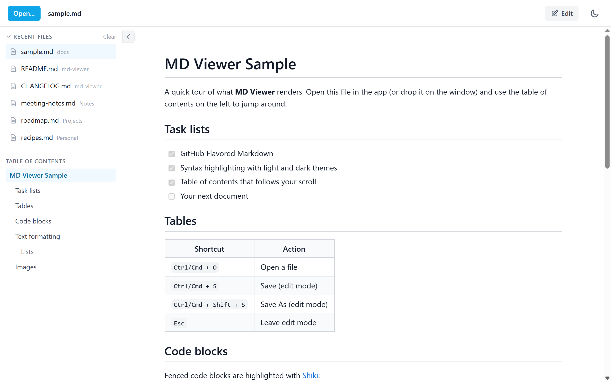
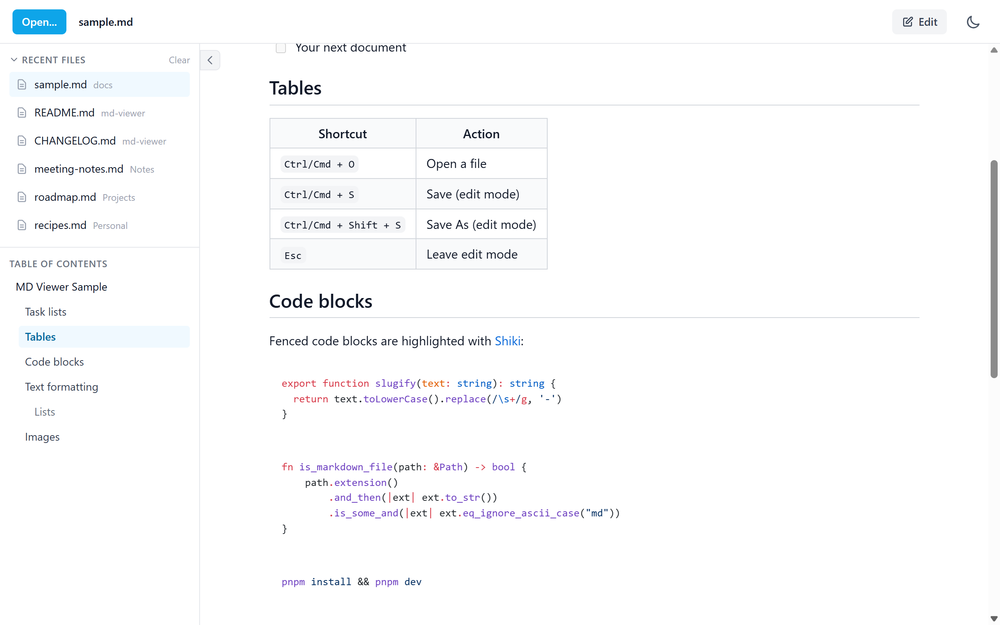
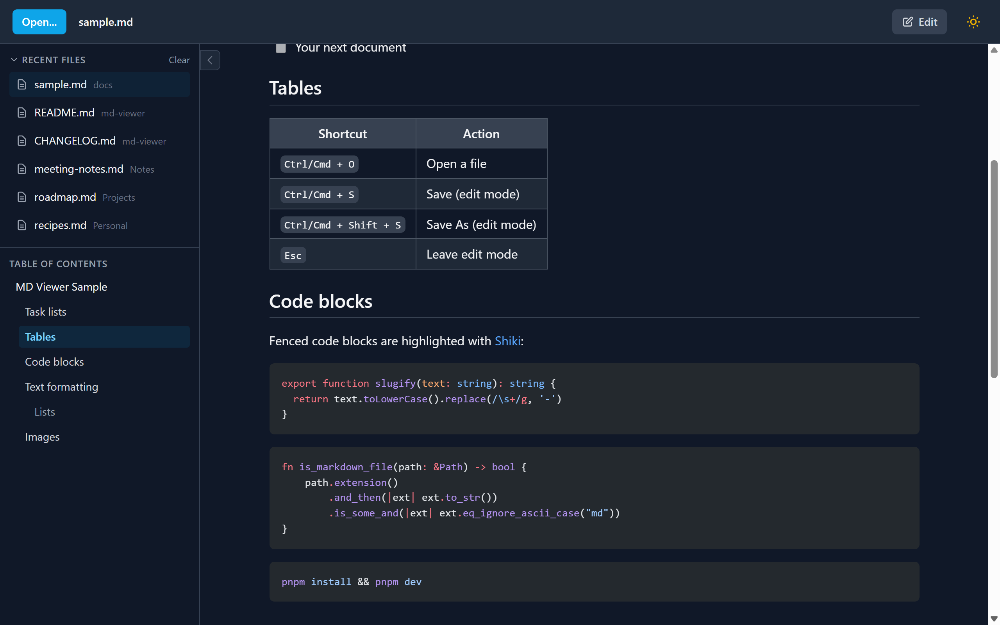
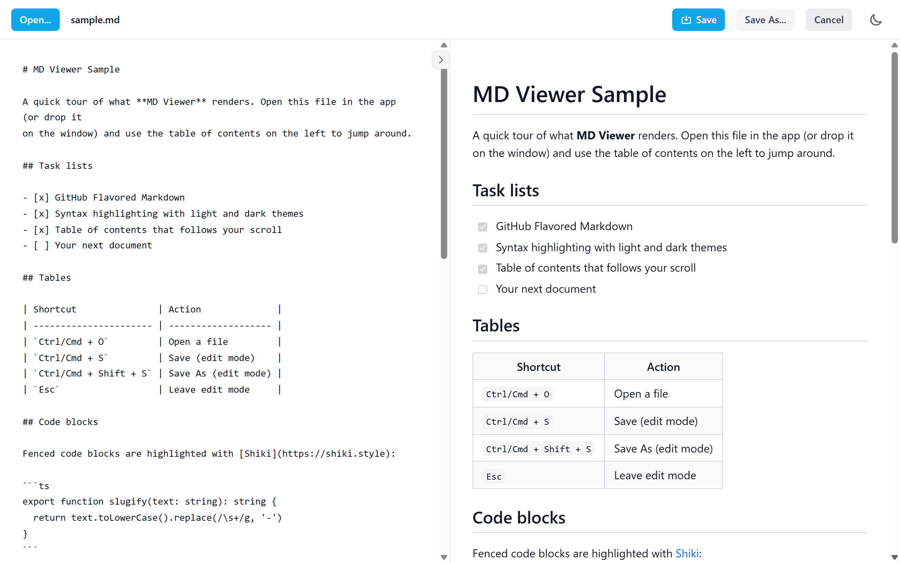

<div align="center">


# MD Viewer

**A fast, minimal desktop app to read and edit Markdown files.**

[](https://github.com/akaneghro/md-viewer/actions/workflows/ci.yml)
[](https://github.com/akaneghro/md-viewer/releases/latest)
[](https://github.com/akaneghro/md-viewer/releases)
[](LICENSE)
[](#download)

[Download](#download) · [Features](#features) · [Build from source](#build-from-source) · [Changelog](CHANGELOG.md)



</div>

MD Viewer opens `.md` files in a clean, GitHub-style reader with syntax highlighting,
a table of contents and dark mode. You can also edit and save them with a live preview.
It is a small native app built with [Tauri](https://tauri.app). It works offline and
sends no data anywhere.

| Light | Dark |
| :---: | :---: |
|  |  |

## Download

Get the latest installer for your system from the
**[Releases page](https://github.com/akaneghro/md-viewer/releases/latest)**:

| Platform | File | Notes |
| --- | --- | --- |
| Windows 10/11 (x64) | `.msi` or `-setup.exe` | Either one works. The installer registers MD Viewer for `.md` files. |
| macOS (Apple Silicon & Intel) | `_universal.dmg` | Open it and drag **MD Viewer** to Applications. |
| Linux (x64) | `.AppImage`, `.deb` or `.rpm` | AppImage runs anywhere. Use `.deb` on Debian/Ubuntu and `.rpm` on Fedora/openSUSE. |

Want to try it on something? Download [`docs/sample.md`](docs/sample.md) and open it.

### First launch

The builds are not code-signed yet, so your OS will warn you the first time:

- **Windows**: SmartScreen says "Windows protected your PC". Click **More info → Run anyway**.
  If WebView2 is missing (rare on Windows 10/11), the installer downloads it.
- **macOS**: Right-click the app in Applications and choose **Open**, then confirm.
  On macOS 15 or later, try to open it once, then go to **System Settings → Privacy & Security** and click **Open Anyway**.
  If macOS says the app "is damaged", remove the quarantine flag:

  ```bash
  xattr -dr com.apple.quarantine "/Applications/MD Viewer.app"
  ```

- **Linux**: The packages need WebKitGTK 4.1, which `.deb` and `.rpm` installs pull in automatically.
  - `.deb`: `sudo apt install ./MD*.deb`
  - `.rpm`: `sudo dnf install ./MD*.rpm`
  - AppImage: `chmod +x MD*.AppImage` and run it. On Ubuntu 22.04+ it may also need FUSE 2
    (`sudo apt install libfuse2`, or `libfuse2t64` on 24.04).

## Features

- **Reader**: GitHub-style rendering of
  [GitHub Flavored Markdown](https://github.github.com/gfm/): tables, task lists, strikethrough and autolinks.
- **Syntax highlighting**: [Shiki](https://shiki.style) with GitHub's light and dark themes, for about 30 common languages.
- **Table of contents**: built from the `h1`–`h3` headings. Click to jump; the current section is highlighted as you scroll.
- **Dark mode**: follows your system on first launch, then remembers your choice.
- **Recent files**: your last 10 documents, one click away. Files that no longer exist are removed from the list.
- **Open your way**: the **Open...** button, the File menu, drag & drop onto the window, or double-click a
  `.md` / `.markdown` / `.mdown` / `.mkd` file. Opening another file reuses the running window.
- **Edit mode**: a side-by-side editor with live preview, **Save** and **Save As**, and a prompt before unsaved changes are discarded.
- **Images & links**: relative images next to the document are shown, and external links open in your default browser.



### Keyboard shortcuts

| Shortcut | Action |
| --- | --- |
| <kbd>Ctrl</kbd>/<kbd>Cmd</kbd> + <kbd>O</kbd> | Open a file |
| <kbd>Ctrl</kbd>/<kbd>Cmd</kbd> + <kbd>S</kbd> | Save (edit mode) |
| <kbd>Ctrl</kbd>/<kbd>Cmd</kbd> + <kbd>Shift</kbd> + <kbd>S</kbd> | Save As (edit mode) |
| <kbd>Esc</kbd> | Leave edit mode |

### Privacy & security

- **Local only**: no accounts, no telemetry, no network requests apart from remote images in your documents.
- **Safe rendering**: raw HTML in Markdown is not rendered, the output is sanitized,
  and `javascript:` and other unsafe links are blocked.
- **Scoped file access**: the app can only read and write the files you open or save (plus images in their folder).
- **Remote images** load over HTTPS only. Plain `http://` images are blocked.

See [SECURITY.md](SECURITY.md) to report a vulnerability.

## Build from source

### Prerequisites

- [Node.js](https://nodejs.org) 22.22.3+ or 24.15+
- [pnpm](https://pnpm.io) 10 (`corepack enable` picks the version pinned in `package.json`)
- [Rust](https://www.rust-lang.org/tools/install) stable (1.90+)
- The Tauri system dependencies for your OS: see [Tauri prerequisites](https://v2.tauri.app/start/prerequisites/)
  (WebView2 on Windows, Xcode Command Line Tools on macOS, WebKitGTK and friends on Linux)

### Commands

```bash
git clone https://github.com/akaneghro/md-viewer.git
cd md-viewer
pnpm install

pnpm dev        # run the desktop app with hot reload (Nuxt on port 3000)
pnpm build      # build installers into src-tauri/target/release/bundle/

pnpm test       # frontend unit tests (Vitest)
pnpm lint       # ESLint
pnpm typecheck  # vue-tsc
cd src-tauri && cargo test   # Rust unit tests
```

### Releases

Pushing a `v*` tag (for example `v0.2.0`) runs the [release workflow](.github/workflows/release.yml).
It builds Windows, macOS (universal) and Linux bundles and attaches them to a **draft** GitHub release
for review. Keep the version in sync in `package.json`, `src-tauri/Cargo.toml` and `src-tauri/tauri.conf.json`.

## Project structure

```
md-viewer/
├── app/                      # Nuxt 4 frontend (SPA)
│   ├── components/           # TopBar, MarkdownViewer, MarkdownEditor, TableOfContents, RecentFiles...
│   ├── composables/          # useDocument, useColorMode, useDragDrop
│   ├── stores/               # Pinia store for recent files
│   ├── utils/                # Markdown pipeline (unified + Shiki), constants
│   └── pages/index.vue       # Main layout, shortcuts, Tauri events
├── src-tauri/                # Tauri 2 backend (Rust)
│   ├── src/lib.rs            # Commands, menu, single instance, file-open handling
│   ├── capabilities/         # Permissions granted to the frontend
│   ├── nsis/                 # Windows installer hooks
│   └── tauri.conf.json       # App, security (CSP) and bundle config
├── docs/                     # Sample document and screenshots
└── .github/                  # CI, release workflow, issue templates
```

## Tech stack

- **Desktop**: [Tauri 2](https://tauri.app) (Rust) with the dialog, fs, opener and single-instance plugins
- **Frontend**: [Nuxt 4](https://nuxt.com) in SPA mode, Vue 3, [Tailwind CSS 4](https://tailwindcss.com), Pinia
- **Markdown**: [unified](https://unifiedjs.com) (remark-gfm, rehype-sanitize) and [Shiki](https://shiki.style)
- **Tooling**: TypeScript, ESLint, Vitest, pnpm

## Contributing

Issues and pull requests are welcome. Please read [CONTRIBUTING.md](CONTRIBUTING.md) first.

## License

[MIT](LICENSE) © 2026 Alberto Alonso
